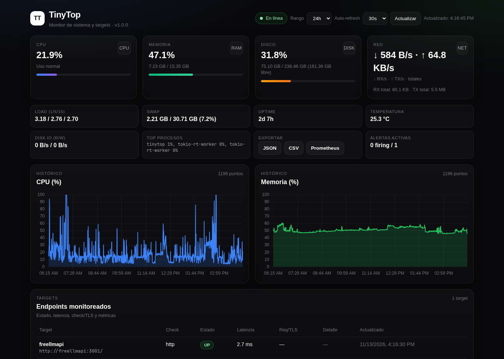

# TinyTop v0.0.1 - Monitor ligero de VPS en Rust

[](LICENSE)
[](Cargo.toml)
[](https://www.rust-lang.org)
[](https://www.kernel.org)



**TinyTop** es un monitor autohospedado y ligero para servidores/VPS. Recolecta métricas del sistema y sondea targets HTTP configurables, persiste histórico en SQLite y expone un dashboard web con gráficos en tiempo real.

## Características

- **Sistema**: CPU (%), memoria usada/total (%), disco usado/total/disponible (%), red acumulada y **tasas RX/TX por segundo** calculadas entre muestras.
- **Targets HTTP**: chequeo por endpoint con `kind` (`generic`, `spring-boot`/`spring`, `quarkus`, `micronaut`/`micrometer`), latencia, estado normalizado, extracción heurística de `http_requests` (JSON/Actuator/texto de métricas) y detalle de error acotado.
- **Persistencia y retención**: SQLite (WAL) con tablas separadas `system_metrics` y `target_metrics`, histórico por rango (`/api/metrics/history?range=&target=system|<name>`), pruning automático por retención.
- **API**: `/api/health` (readiness/db/runtime), `/api/metrics/latest`, `/api/metrics/history`, `/api/config` con errores JSON y códigos HTTP consistentes (404/400/5xx).
- **Dashboard**: HTML/CSS/JS embebido + Chart.js servido localmente (`/static/vendor/chart.umd.min.js`, sin CDN), controles de rango y auto-refresh, estados vacíos/carga/error, render seguro de targets (DOM + escape), tabla y tarjetas accesibles.
- **Operación**: apagado ordenado (SIGINT/SIGTERM), logging con `tracing`, configuración por archivo + overrides de entorno, validación de config (puerto/rangos/nombres únicos/URLs).
- **Docker**: imagen multi-stage, usuario no-root, volumen de datos, `HEALTHCHECK`, variables de entorno para config y DB.

## Configuración

`config.toml` (ejemplo):

```toml
port = 9090
db_path = "tinytop.db"
interval_seconds = 30
retention_hours = 168
request_timeout_secs = 5

[[targets]]
name = "localhost"
url = "http://localhost:8080/actuator/health"
kind = "spring-boot"

[[targets]]
name = "api"
url = "http://localhost:3000/api/health"
kind = "generic"
```

### Variables de entorno

| Variable | Descripción | Default |
|---|---|---|
| `TINYTOP_CONFIG` | Ruta al archivo de configuración | `config.toml` |
| `TINYTOP_PORT` | Puerto HTTP | `9090` |
| `TINYTOP_DB_PATH` | Ruta de la base SQLite | `tinytop.db` |
| `TINYTOP_INTERVAL` | Intervalo de recolección (segundos) | `30` |
| `TINYTOP_RETENTION_HOURS` | Retención de histórico (horas) | `168` |
| `TINYTOP_REQUEST_TIMEOUT_SECS` | Timeout de sondeo de targets (segundos) | `5` |

## API

- `GET /` — dashboard web
- `GET /api/health` — estado/readiness (`db.ok`, `runtime`, última colección, errores, versión)
- `GET /api/metrics/latest` — `{ system: {...} | null, targets: [...] }`
- `GET /api/metrics/history?range=24&target=system` — `{ target, range_hours, points: [...] }` (sistema)
- `GET /api/metrics/history?range=24&target=<name>` — histórico del target (404 si no existe)
- `GET /api/config` — configuración efectiva

## Ejecución local

```bash
cargo build --release --locked
./target/release/tinytop
# http://localhost:9090
```

## Docker

```bash
docker compose up -d --build
# http://localhost:9090
```

- DB persistida en volumen (`/app/data/tinytop.db` por defecto en la imagen/compose).
- Healthcheck: `curl -fsS http://localhost:9090/api/health`.
- Ejecuta como usuario no-root.

## Pruebas y calidad

```bash
cargo fmt --all -- --check
cargo clippy --all-targets --locked -- -D warnings
cargo test --all-targets --locked
```

Pruebas E2E (Playwright, requiere servidor corriendo y accesible):

```bash
npm ci
npx playwright install --with-deps chromium
BASE_URL=http://localhost:9090 npx playwright test
```

El workflow de CI ejecuta fmt, clippy, tests, build y E2E en Ubuntu.

## Seguridad y notas

- Sin autenticación incorporada: expón el servicio detrás de reverse proxy con TLS/auth si es accesible públicamente.
- Las URLs de targets se leen de configuración local/controlada por el operador.
- `Cargo.lock` incluido para builds reproducibles.

## Licencia

MIT - Copyright (c) 2026 TinyTop Contributors

## Agradecimientos

- [Rust](https://www.rust-lang.org), [Tokio](https://tokio.rs), [Axum](https://github.com/tokio-rs/axum), [SQLx](https://github.com/launchbadge/sqlx), [sysinfo](https://github.com/GuillaumeGomez/sysinfo), [Chart.js](https://www.chartjs.org/)